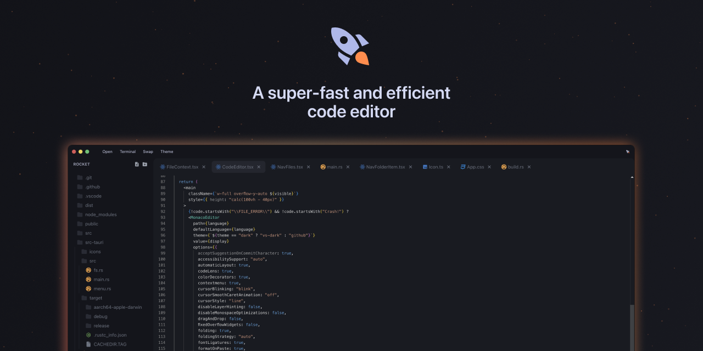

Welcome to Rocket, a super-fast, ram-efficient, and lightweight code editor that's ready to ship your code to the next level! 🚀

> Rocket has been made to Public Beta. This is meant to be a fun project but here we are.

### What's new in v0.2.0
- Increased Bounding box
- Image previews
- Add folders into a folder (sub-directory)
- Stricter Permissions
- OTA Updater

### TODO
- [ ] Drag and move files and folders
- [ ] Functionality for Copy-Cut-Paste in files and folders
- [ ] Squash Bugs
- [x] Image previews
- [x] Increased Bounding box
- [x] Add folders into a folder (sub-directory)
- [x] Stricter Permissions
- [x] OTA Updater
- [x] Menu bar items
- [x] Universal build
- [x] Reorder opened files
- [x] Resizable Folder View
- [x] Swap positions

## Why Choose Rocket?

### ⚡ Blazing Fast
Rocket is built for speed. It’s like a coding cheetah on a caffeine high. You’ll never have to deal with annoying lags again.

### 🪶 Light as a Feather
Rocket is tiny compared to most code editors. It’s designed to be as lightweight as possible, so it won’t gobble up your system resources. More room for your other important stuff! (Made in Tauri instead of Electron)

### 🔧 Just the Essentials
Rocket focuses on giving you the basics without the bloat:
- **Syntax Highlighting**: Supports lots of programming languages.
- **Code Autocompletion**: Helps you write code faster with smart suggestions.
- **Clean Interface**: A minimalist design that keeps you focused on your code.
- **No Learning Curve**: Using Monaco editor under the hood, which is the core of the VSCode.

### 🎨 Modern and Sleek
Rocket's interface is modern and sleek, making your coding sessions a visual treat. It’s designed to be easy on the eyes and boost your productivity.

### 🌍 Made for macOS
Rocket is built to work seamlessly on `macOS` with `Apple Silicon` and `Intel`. No fuss, no muss—just smooth coding on your favorite platform.

## The Trade-Offs

We love Rocket, but let's be real. it’s not perfect. Here are a few things to keep in mind:
- **No Extension Support**: What you see is what you get. No add-ons here due to [limitations on monaco editor](https://github.com/Microsoft/monaco-editor/issues/430#issuecomment-306870048).
- **Limited Formatting Options**: Necessary tools only, but they get the job done.
- **Minimal Debugging Tools**: Simple and straightforward, but not fancy.
- **No Integrated Terminal**: You’ll need to use an external terminal for your command-line tasks.

> You don't have to create a new terminal, click on Terminal button to open it from your project directory.


## Installation

Ready to get started? Here’s how to install Rocket on your Mac:

1. Download the DMG file from [Github](https://github.com/Rahuletto/rocket/releases).
2. Open the DMG file and drag Rocket to your Applications folder.
3. Launch Rocket and get ready to code!

## Agent sidebar

Rocket uses the local Codex CLI as its default agent runtime. Install Codex and
ensure `codex` is available on `PATH`; Rocket starts
`codex app-server --stdio` in the open workspace.

The composer supports:

- `/` host commands such as `/help`, `/clear`, `/model`, and `/connect`
- `@` workspace-file completion
- `$` agent-tab completion
- `#` workspace skills from `.agents/skills/*/SKILL.md`

Provider preferences are stored in `~/.rocket/config.json`. Credentials entered
through `/connect` are stored in `~/.rocket/credentials.json` with user-only
permissions and are never persisted in renderer storage.

Rocket also detects these environment variables:

```text
ANTHROPIC_API_KEY
OPENAI_API_KEY
OPENROUTER_API_KEY
CF_ACCOUNT_ID
CF_API_TOKEN
OPENAI_COMPATIBLE_API_KEY
```

Ollama defaults to `http://127.0.0.1:11434/v1`; LM Studio defaults to
`http://127.0.0.1:1234/v1`. Lava/Flue-backed providers can be configured now,
but their models remain disabled until the Lava sidecar runtime lands.

<details>
  <summary>“Rocket” cannot be opened because the developer cannot be verified.</summary>
  
  ### Are you seeing a prompt like this?
  

  

  This is expected as I didn't sign the application using Apple Developer ID
  > In short, Apple wants me to pay a fee to remove that prompt + publish to App Store

  This will prompt only once after installation. We can override this by opening 
  - `System Settings` > `Privacy & Security`
  - Scroll down

    
  

  
  - Click `Open Anyway`

    


- Click `Open`, don't worry. This is an open source project. It will not harm your mac or compromise your privacy.

  
</details>


## Contributing

### Language-server security boundary

Rocket launches the TypeScript language server with a cleared environment. The safe
allowlist copied to it is `PATH`, `HOME`, `TMPDIR`, `TMP`, `TEMP`, `SystemRoot`, `WINDIR`,
and `PATHEXT`; provider credentials and other application variables are not inherited.
All file URIs returned by the server are parsed with a standards-compliant URL library,
canonicalized, and required to remain under the canonical workspace root before a
response reaches Monaco. A workspace edit is rejected as a whole when any target fails
that check, and code-action commands are removed (workspace edits remain available).
LSP framing permits at most 8 KiB of headers and a 16 MiB body. Graceful shutdown is
bounded, after which Rocket kills and reaps the server process group on Unix. Windows
uses `taskkill /T`; a descendant deliberately detached from that process tree is a known
platform limitation until native Job Objects are used.

We’d love your help to make Rocket even better. Here’s how you can get involved:
1. Fork the repository on GitHub.
2. Create a new branch for your feature or bug fix.
3. Make your changes and commit them with clear, descriptive messages.
4. Push your changes to your fork and submit a pull request.

Please make sure your code follows our coding standards and is well-documented.

## Community and Support

Join our awesome community of developers:
- [GitHub Discussions](https://github.com/Rahuletto/rocket/discussions)
- [Discord Server](https://discord.gg/3JzDV9T5Fn)

If you run into any issues or have questions, reach out on our [support channel](https://discord.gg/3JzDV9T5Fn).

## License

Rocket is released under the Attribution-NonCommercial-NoDerivatives License. Check out the [LICENSE](LICENSE) file for more details.

---

Happy coding with Rocket! 🚀
